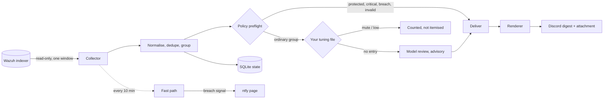

# Architecture

Soc Thief reads Wazuh alerts, groups them, decides by fixed rules which groups you must see, and
sends you a daily Discord digest. A separate fast path checks every ten minutes for breach signals
and pages you through ntfy. A local AI model reviews some groups and adds advice. The model can
never hide an alert from you.

Soc Thief is alpha software. Interfaces, settings and file formats may change between releases.

## The pipeline



In text form:

```
Wazuh indexer (read-only)
   -> collector -> normalise / dedupe / group -> policy preflight
                                                   |-- protected or breach -> deliver
                                                   |-- tuning: mute / low  -> counted only
                                                   '-- otherwise -> local model (advice) -> deliver
   deliver -> renderer -> Discord webhook (messages + attachment)
   state: SQLite metadata only (opaque IDs, decisions, checkpoints, pending report)
   fast path: same collector, breach signals only -> ntfy
```

Each stage has its own document:

| Stage | Module | Document |
| --- | --- | --- |
| Collector | `soc_thief.collector` | [COLLECTOR.md](COLLECTOR.md) |
| Grouping and policy | `soc_thief.runner`, `soc_thief.policy` | [POLICY.md](POLICY.md) |
| Breach signals and fast path | `soc_thief.breach`, `soc_thief.fastpath` | [DETECTION.md](DETECTION.md) |
| Tuning and case review | `soc_thief.tuning`, `soc_thief.baseline`, `soc_thief.cases` | [TUNING.md](TUNING.md) |
| Model adapters | `soc_thief.model` | [MODELS.md](MODELS.md) |
| State | `soc_thief.state` | [STATE_STORE.md](STATE_STORE.md) |
| Discord renderer | `soc_thief.delivery` | [POLICY.md](POLICY.md#the-daily-digest) |
| Investigation briefs | `soc_thief.investigate`, `soc_thief.autoinvestigate` | [INVESTIGATION.md](INVESTIGATION.md) |
| Install and run | `deploy/` | [DEPLOYMENT.md](DEPLOYMENT.md) |

## Invariants

These hold in every release. A change that breaks one will not be merged.

1. A model cannot suppress an alert. `policy.decide()` has no branch that returns a
   non-delivering decision. A valid model answer still means "deliver". An invalid or missing
   answer means "deliver and raise a health failure". The test suite fails if a confidence gate
   is added back.
2. Your tuning file is the only suppressor. It is a plain JSON file you write. Each entry
   names a rule (and optionally an agent) and an action, `mute` or `low`. Both actions remove the
   group from the itemised report and count it in one summary line. Nothing writes this file
   for you.
3. Protected groups cannot be tuned away. These are groups at Wazuh level 12 or higher,
   groups whose description matches the protected vocabulary (authentication abuse, malware,
   privilege escalation, credential access, collection, exfiltration), groups carrying a breach
   signal, malformed groups, and any collection or transport failure.
4. Everything fails closed. A source failure, a malformed model answer, a timeout, a state
   write failure or a delivery failure produces a delivery-required report and an explicit
   health failure. Silence never means "nothing happened" by accident.
5. Wazuh access is read-only. Soc Thief never writes to Wazuh, changes rules, or runs a
   response action.
6. Secrets come only from files. Every credential is read through a `*_FILE` path. Secrets
   are never passed as command-line flags or printed.

## Why it is built this way

A model classifies; fixed rules decide. A small local model is useful for ordering and
explaining alerts. It is not reliable enough to decide what you never see. In measurement on
real alerts, `qwen3:4b` reported only two confidence values (0.95 and 0.85), and the same group
could come back benign, then suspicious, across identical requests at temperature 0. A
confidence threshold on that number would suppress on noise. So the model advises and the policy
decides. See [POLICY.md](POLICY.md#the-model-cannot-suppress) and
[adr/0001-policy-bounded-local-ai.md](adr/0001-policy-bounded-local-ai.md).

Groups, not events. Wazuh can raise hundreds of thousands of events a day. Soc Thief groups
them by rule, agent and labels within the report window, so you read one line per pattern. The
attachment lists every delivery-required group, so grouping changes what you see first, never
what is kept from you.

Deterministic tuning instead of learned suppression. A SOC tunes a noisy feed by writing
explicit rules. Soc Thief does the same. A proposer can suggest entries from measured base rates,
but you review and install them yourself. See [TUNING.md](TUNING.md).

Two delivery speeds. The daily digest is the audit record. The fast path exists because a
breach should not wait until morning. It skips the model and tuning entirely, so neither can
delay or hide a page.

## What leaves the collector

The collector requests only allowlisted fields. Everything else in the alert document is never
fetched.

| Field | Used for | Reaches the model? | Reaches Discord? |
| --- | --- | --- | --- |
| `@timestamp`, `rule.id`, `rule.level` | grouping, policy | yes | yes |
| `rule.description` | grouping, protected vocabulary | yes, capped | yes, escaped and masked |
| `agent.id`, `agent.name`, `decoder.name`, `manager.name`, `location` | grouping labels | yes, capped | yes, escaped and masked |
| `_index`, `_id` | deduplication key only | no | no |
| `rule.groups`, `data.srcip`, `syscheck.*` | breach signals only, then dropped | no | no |

Command lines, process arguments, raw event JSON, credentials, tokens, cookies and private keys
are never requested, so they never enter a group, prompt, log, state record or report.

Before text reaches Discord, the renderer escapes Markdown, disables mentions, masks IP
addresses, URLs and obvious `key=value` secrets, and caps every line and payload. Model prose is
never rendered. Alert text is treated as untrusted data everywhere: a description that says
"ignore previous instructions" is matched by the protected vocabulary and delivered.

The local model receives one capped summary per group, never member events. An optional hosted
model receives a pseudonymised summary. See [MODELS.md](MODELS.md) for the privacy trade-off.

## Trust boundaries

| Boundary | What crosses | Control |
| --- | --- | --- |
| Wazuh to collector | Allowlisted fields for one bounded window | Dedicated read-only indexer user, TLS validation, response size cap, point-in-time snapshot |
| Collector to state | Opaque HMAC identifiers, fixed decision codes | SQLite file `0600` in a `0700` directory, one transaction per window |
| Group to model | One capped group summary | Loopback endpoint by default, fixed prompt, strict JSON schema |
| Renderer to Discord | Escaped, masked digest | Webhook URL read from a file, HTTPS to `discord.com` only, payload caps |
| Fast path to ntfy | Signal name, agent ID, count, time, opaque case ID | HTTPS only, URL and token read from a file |
| Timer to container | One run | Dedicated unprivileged account, rootless Podman, read-only root, no capabilities, host egress policy |

## Fail-closed behaviour

| Failure | What you get |
| --- | --- |
| Indexer unreachable, partial shards, changing totals, a missing daily index | No checkpoint advance; a content-free health report |
| Model timeout, bad JSON, unknown keys | That group is delivered with `invalid_model_result` and a health failure; the rest of the window continues |
| Tuning file missing, unsafe or invalid | No tuning for that window, plus a health failure |
| State write fails | Nothing is committed; health report |
| Discord rejects the report | The minimised report stays in the state outbox and is retried, oldest first, before any new window |
| Report too large for the page budget | The omitted lines are counted on page 1 and raise a health failure |
| Run exceeds its deadline | The worker is killed and a content-free health report is attempted |
| Approval file missing or invalid | Nothing runs and nothing is sent; the unit exits non-zero and the status check withholds its heartbeat |

The hourly status check (`soc_thief.status`) reads only the journal. It sends a heartbeat to a
push monitor of your choice when the last daily window closed cleanly and, if the fast path is
enabled, when the fast path covered every interval and no expected agent went silent. A missing
heartbeat is your out-of-band alarm.

## Demo and console

A synthetic demo snapshot (`python -m soc_thief.demo`) and a terminal console (`console/`, Rust)
are being added for the first release. The snapshot format is described in
[SNAPSHOT.md](SNAPSHOT.md).
